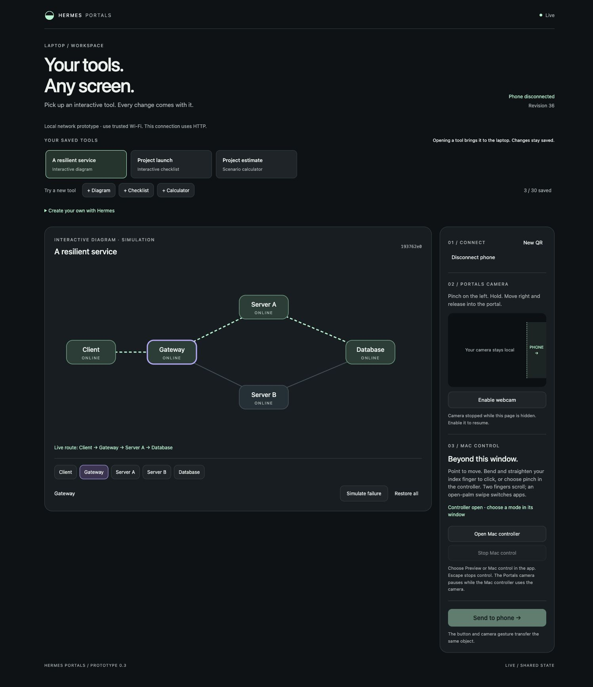
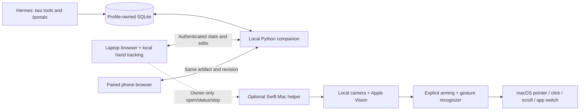

# Hermes Portals

**Your tools. Any screen.**

Create portable interactive tools with Hermes and move them between a laptop
and a paired phone. Diagrams, checklists and calculators keep the same ID and
saved state through every handoff. A library keeps each tool's changes when
you switch to another one.
Use the laptop's webcam to pinch, hold, move right and release into a portal.
The phone is selected by pairing first; the camera does not identify physical
phones or infer where devices are in the room.

On macOS, an optional native controller also turns hand gestures into pointer
movement, clicks, scrolling and switching running apps. It continues tracking
while another app is in front. [Mac setup and gesture guide](docs/MAC_CONTROL.md).



**Version 0.3.0 · MIT · community plugin · trusted-LAN prototype.**
This is an independent project, not an official Nous Research product.
[Calculator workspace](docs/screenshots/laptop-calculator.jpg) ·
[Phone-sized calculator view](docs/screenshots/phone-calculator.jpg)

## What works

- Native Hermes `/portals` command, general `portals_app` tool and compatible
  `portals_diagram` tool through public APIs.
- Three data-only tool types: interactive diagrams, checklists with saved ticks,
  and calculators with numeric inputs, sliders and sum/product outputs.
- A persistent library of up to 30 tools; one active tool is shared at a time.
  Create from Hermes or try a sample from the page, then reopen it later.
- One laptop owner and one paired phone, with single-use QR invitations.
- Shared state over an authenticated WebSocket, transactional edits, reconnect
  snapshots, persistent tools and device revocation.
- A local MediaPipe hand tracker and a deliberate pinch/hold/move/release gesture.
- An optional macOS camera controller using Apple's Vision framework, with
  preview/control modes, deliberate palm arming, Escape stop and a display picker.
- English/Bulgarian camera instructions, automatic pointer recovery after
  tracking loss, and selectable index-tap or thumb/index-pinch clicking. Physical
  usability trials are tracked in [validation](docs/VALIDATION.md).
- Native controller open/status/stop from Hermes and the authenticated localhost
  laptop page. The paired phone has no native control access.
- A touch-friendly phone view. Button handoff remains available with the camera off.
- Hermes can create a custom node/edge diagram, simulate node failures, restore
  nodes and transfer the current artifact. This never changes real infrastructure.

## Setup

The Hermes adapter requires **Hermes 0.20.5+**; use **0.23.0+** for the
current catalog validation command. The companion needs macOS or
Linux, `uv`, Node.js 22+ / npm, `curl`, and Python 3.11 (which `uv` can provision).
The optional native controller needs **macOS 13+ and Xcode Command Line Tools**.
Chrome on the laptop is the initial browser target. A phone needs only a browser
on the same trusted Wi-Fi; Safari on an iPhone was used in the physical trial.

### Install from source

Until catalog approval, install the repository by URL. Review the source first:

```bash
hermes plugins install https://github.com/ochikov/hermes-portals
cd "${HERMES_HOME:-$HOME/.hermes}/plugins/hermes-portals"
./scripts/setup.sh
```

For a named Hermes profile, use its plugin directory instead of the default
path above. The install output identifies the location. Setup is an explicit
step: installing/enabling the adapter does not download assets, start a server,
open a camera or grant OS permissions.

To include Mac gesture control, use `./scripts/setup.sh --with-mac` instead.
It builds the Swift source locally and runs pure recognizer checks. No prebuilt
native binary is included. The helper is ad-hoc signed, not notarized; rebuilding
may require renewing Camera/Accessibility permission in System Settings.

Setup creates an isolated `.venv`, installs hash-locked Python dependencies and
the exact npm lockfile, then prepares the pinned hand-tracking runtime/model.
The manifest declares `python_runtime: external`; no companion dependencies are
installed into Hermes's Python environment. The adapter itself is stdlib-only.

For a local development checkout, install that directory with Hermes instead:

```bash
hermes plugins install /absolute/path/to/hermes-portals
hermes plugins validate /absolute/path/to/hermes-portals --install-deps
hermes plugins enable hermes-portals --no-allow-tool-override
```

Use a fresh Hermes conversation after enabling the plugin. In that conversation:

```text
/portals start <this-laptop-private-IPv4-address>
```

`/portals start` without an address listens only on loopback; it is suitable for
local development but a physical phone cannot reach it. In LAN mode the service
listens on port 8766 on all IPv4 interfaces, with accepted Host/Origin values
limited to localhost and the configured LAN address. It does not change the
firewall, router, Tailscale, or Hermes gateway settings.

1. Open the command's **one-use localhost laptop link** within two minutes.
2. On the same trusted Wi-Fi, scan its QR code with the phone's normal camera app.
3. Name the phone and press **Connect to Portals**.
4. On the laptop press **Enable webcam** and allow this local page to use it.
5. Show one hand. In the mirrored camera preview, pinch on the left, hold about
   0.2 seconds, move right while pinching, then open your fingers inside the
   marked PHONE region. A fast wave alone does not transfer anything.
6. Edit the tool on the phone and use **Return to laptop**. The state stays intact.
7. Try **+ Checklist** or **+ Calculator**. Switch between saved tools from the
   laptop library. Calculator sliders save on release; typed values save with
   Enter or **Save changes**, and also save before a handoff or tool switch.

The laptop camera needs `http://127.0.0.1`/`http://localhost` or HTTPS. Do not
open the laptop view through its HTTP LAN address and expect webcam permissions.
The phone receiver does not request camera access itself.

Other commands:

```text
/portals open       # new one-use laptop invitation
/portals status     # service, active tool, library and phone status
/portals revoke     # revoke phone and return active tool to laptop
/portals stop       # gracefully stop companion; keep saved tools
/portals mac open   # open Mac controller; choose Preview or Control there
/portals mac status # native capture/control and permission status
/portals mac stop   # stop native camera/input; leave the menu bar app open
```

Each `/portals open` invalidates older unredeemed owner invitations. Redeeming
a new owner invitation replaces the prior owner session. Restarting the service
requires pairing again, while preserving all saved tools. An interrupted phone
can reconnect with its existing session while that service remains running.
The native Mac controller is independent: `/portals stop` does not stop it.
Use `/portals mac stop`, Escape, its Stop button or Quit for that mode.

Standalone developer use (same backend and state model):

```bash
.venv/bin/python scripts/portals.py --data-dir .runtime/demo start <laptop-IP>
.venv/bin/python scripts/portals.py --data-dir .runtime/demo open
.venv/bin/python scripts/portals.py --data-dir .runtime/demo stop
```

## Hermes example

In a fresh Hermes conversation after enabling/updating the plugin, ask:

- “Create a Portals checklist for my project launch: review scope, test the
  prototype, collect feedback, and prepare release notes.”
- “Create a Portals calculator for team size × working days × daily cost.”
- “List my saved Portals tools, open the launch checklist, and send it to my phone.”

`portals_app` supports status/list, create, template, open, set_item, set_value
and handoff. It reads the current workspace revision before every mutation.
The companion must be running for browser delivery, and the phone must be
paired and online for handoff. Tool creation itself can happen while stopped.
See [the portable tool contract](docs/PORTABLE_TOOLS.md) for payload examples,
supported calculations and extension points.

Ask Hermes: “Use Portals to disable Server A in the demo diagram and send it to
my paired phone.” The `portals_diagram` tool reads `status`, then applies an
explicit mutation using the latest revision. Concurrent edits receive a conflict
instead of silently overwriting another device's changes.

For `show`, the tool accepts a bounded data-only graph: a title, 2–12 nodes
`{id,label,x,y}`, up to 30 directed edges `[from,to]`, and `source`/`sink` IDs.
Coordinates range from 0.08 to 0.92. The renderer changes layout on narrow screens.
It does not execute HTML or JavaScript supplied by a model. Node failures and
the resulting route are a deterministic graph demonstration, not a capacity,
reliability or load simulation of a real deployment.

## Architecture



The Python adapter registers two tools and one command. It resolves
`plugins.plugin_storage.plugin_data_dir("hermes-portals")` on each invocation
so profiles keep separate databases. The companion is a separate Python process
started only by an explicit command, with a minimal environment that excludes
provider credentials and approval flags. No daemon or launch-at-login service
is installed.

Hermes and the companion share a profile-owned SQLite workspace and tool library. Web clients
send schema-validated REST mutations with an expected revision. Read-only
WebSockets push changes and periodic heartbeats; the service notices native
Hermes edits through a short database poll. Reconnecting clients receive a full
snapshot. The browser keeps no independent authoritative saved copy. Numeric
previews are committed before changing tools or handing off. Version 0.1
diagrams migrate without changing their identity or interaction state.

The laptop tracks 21 hand landmarks locally using pinned MediaPipe assets. Its
gesture recognizer uses palm-normalized pinch distance, hysteresis, a hold time,
minimum movement, a target region and a cooldown. Missing hands cancel grabs.
Gestures use exactly the same validated handoff endpoint as the transfer button.

The optional Swift/AppKit helper uses AVFoundation and Vision on a separate
camera queue. Its pure recognizer emits bounded actions only after explicit
native control activation and a palm hold; Accessibility permission gates event
delivery. The helper accepts no remote input. A private heartbeat file and
stop-request file connect it to the companion. Native open/status/stop routes
require both the authenticated owner and a loopback connection/origin.

## Access and network disclosure

- Runtime data remains in the selected profile's `plugin-data/hermes-portals`
  directory: SQLite workspace/library, hashed Portals session/invitation tokens, a
  credential-free runtime descriptor, a service lock and server error log.
- No Hermes messages, provider keys, credential files or arbitrary workspace
  files are exposed to the phone. The native plugin reads only its own data.
- Pairing invitations expire after 120 seconds and can be redeemed once. Sessions
  expire after eight hours. A phone can inspect/control this room's active tool
  and see saved-tool titles/types; only the owner can create/switch tools or
  pair/revoke devices. Revocation also closes live sockets.
- Owner invitations can only be redeemed over loopback. Cookies are HttpOnly and
  SameSite=Strict; requests and WebSockets check the expected origin. Request
  bodies, diagram size, sockets and pairing attempts are bounded.
- **Prototype LAN traffic uses HTTP, without transport encryption. Use a trusted
  private network and nonsensitive demonstration data.** HTTPS, broader device
  discovery, multiple participants and production deployment are future work.
- Browser camera frames and hand inference stay in the browser; nothing records
  or uploads video, audio, screenshots or landmarks. Microphone access is disabled.
  Its camera stops when disabled or the document is hidden/closed. A permission
  request can remain pending until the user allows or denies it; cancellation
  ensures a late-granted stream is immediately stopped.
- The native Mac helper processes camera frames/landmarks locally through Apple
  frameworks. It records/uploads none of them and has no network listener.
  It continues in the background until Stop/Escape/Quit, sleep, session change
  or loss of required permission. Closing its window leaves the menu bar app
  running. Its own private Application Support directory holds status and a
  stop request; native language, sensitivity and click preferences use macOS
  UserDefaults under the helper bundle ID; see [the Mac guide](docs/MAC_CONTROL.md) for permission/setup details.
- Initial setup downloads dependencies from the configured package registries
  and a versioned Google-hosted MediaPipe model, checked against a committed
  SHA-256. The running page uses only locally served code/model assets and its
  Portals server. No analytics, telemetry, CDN runtime fetches or self-updater.
- `/portals start` launches the isolated companion subprocess and `/portals stop`
  requests authenticated shutdown. UI edits never launch shell commands.

## Validation and limitations

```bash
uv pip install --python .venv/bin/python --require-hashes -r requirements-dev.lock
.venv/bin/python -m pytest -q
npm test
hermes plugins validate /absolute/path/to/hermes-portals --install-deps
./scripts/build_macos.sh  # macOS: compile and run pure recognizer self-tests
```

See [validation evidence](docs/VALIDATION.md) for automated results and the
separate manual trials. Physical iPhone pairing, camera handoff, restoration
and return were exercised. The tester also confirmed pointer aiming, clicking,
scrolling and switching apps; this is a usability trial, not an accuracy study.
The checklist/calculator roundtrips were checked with a browser receiver.

One owner, one phone and one active tool per service are supported. Desktop app
processes do not move to the phone. Portable tools are constrained data rendered
by this plugin, not arbitrary downloaded HTML/JavaScript. There is no remote
Hermes-server-to-local-Mac bridge, multi-phone session, TLS transport, dragging,
right click or text-entry gesture. Broad camera, lighting, Android and Linux
hardware coverage remains open. The two camera modes are used separately.

## Development and release

- [Contributing and tests](CONTRIBUTING.md)
- [Security boundaries and reporting](SECURITY.md)
- [Release and catalog procedure](docs/PUBLISHING.md)
- [Third-party components](THIRD_PARTY.md) and [MIT license](LICENSE)

## References

- [Hermes plugin API](https://hermes-agent.nousresearch.com/docs/developer-guide/plugins)
- [Catalog admission](https://hermes-agent.nousresearch.com/docs/developer-guide/plugins/catalog-submission)
- [MediaPipe hand landmarks](https://developers.google.com/edge/mediapipe/solutions/vision/hand_landmarker?tab=Web)
