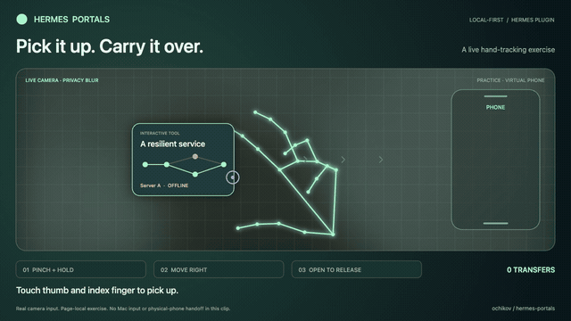

# Hermes Portals

**Let your work move with you.**

[](docs/media/hermes-portals-demo.mp4)

[▶ Watch the 13-second demo](docs/media/hermes-portals-demo.mp4) · [Get started](#start-here) · [Mac gestures](docs/MAC_CONTROL.md)

<sub>Real hand tracking in Gesture Lab. The phone shown is a virtual practice target. Camera imagery was blurred before recording; no audio. <a href="docs/media/README.md">Recording details.</a></sub>

## An idea. A tool. Another screen.

Ask Hermes for a diagram, a checklist or a calculator. Make it yours. Pair your
phone with a QR code, pick up the tool with a hand gesture, and keep working on
the next screen. Your edits travel with it.

- **Create something useful.** Explore a system, work through a launch checklist,
  or change the numbers in a project estimate. Reopen saved tools later.
- **Carry it with you.** Pinch, move and release to hand off to your paired phone.
  Edit there, return to the laptop, and continue with the same saved state.
- **Reach beyond the browser.** The optional Mac controller turns your webcam
  into pointing, clicking, scrolling and app switching with your hand.

No extra tracking hardware. The phone needs only its browser. Buttons work too.

## Start here

**You need:** Hermes **0.20.5+**, macOS or Linux, `uv`, Node.js **22+** / npm,
`curl`, and Python **3.11** (`uv` can provision it). Start with Chrome on the
laptop. For phone handoff, put both devices on the same trusted Wi-Fi.

Install from source, then enable the plugin:

```bash
hermes plugins install https://github.com/ochikov/hermes-portals
cd "${HERMES_HOME:-$HOME/.hermes}/plugins/hermes-portals"
./scripts/setup.sh
hermes plugins enable hermes-portals --no-allow-tool-override
```

For a named Hermes profile, use the plugin directory shown by the installer.
Hermes may also offer to install the declared Node dependency; run setup to
complete the companion environment and camera assets.

In a **fresh Hermes conversation**, start Portals:

```text
/portals start <your-laptop-private-IPv4-address>
```

Use `/portals start` without an address for a laptop-only session. To connect a
phone, supply the laptop's private IPv4 address. **LAN traffic is unencrypted
HTTP: use trusted Wi-Fi and nonsensitive demo content.**

1. **Open** the one-use localhost laptop link within two minutes.
2. **Pair** your phone: scan the QR code, name the phone, then tap **Connect to Portals**.
3. **Carry** the sample diagram: enable the laptop webcam, pinch on the left,
   hold briefly, move right, and open your fingers inside **PHONE**. Or use the
   transfer button.
4. **Continue** on the phone. Make a change, then tap **Return to laptop**.

Now ask Hermes for something of your own:

> Create a Portals checklist for my launch: review scope, test the prototype,
> collect feedback, and prepare release notes.

Or try a calculator for **team size × working days × daily cost**. The laptop
page also has sample tools you can create with a button.

**Want to learn the gesture first?** Open **Try with your hand** on the laptop
page. Gesture Lab gives you a live preview, outlined joints and a practice card.
It works with mouse, touch or keyboard too. Instructions are in English and
Bulgarian; no paired phone is needed for practice.

[Commands and examples](docs/USAGE.md) · [Calculator preview](docs/screenshots/laptop-calculator.jpg) · [Diagram preview](docs/screenshots/laptop-diagram.png)

## Your webcam, a new way to interact

On macOS **13+** with Xcode Command Line Tools, run `./scripts/setup.sh --with-mac`
from the plugin directory. This builds the optional native controller. In Hermes,
run `/portals mac open`, grant **Camera** and **Accessibility**, then start
control and hold an open palm to activate it.

| With your hand | On your Mac |
| --- | --- |
| Point and move | Position the cursor |
| Bend your index finger, then straighten it | Click the target |
| Raise two fingers and move vertically | Scroll |
| Hold an open palm briefly, then swipe sideways | Switch running apps |

**Escape stops camera and input.** Use browser handoff and native Mac control
separately. [Setup, pinch-click alternative and troubleshooting →](docs/MAC_CONTROL.md)

## Before you install

- **Explicit startup.** Installing or enabling the adapter starts no server or
  camera and grants no OS permissions. `/portals start` launches a separate
  Python companion; `/portals stop` stops it. No launch-at-login service is added.
- **Setup downloads.** The setup script runs `uv`, `npm` and `curl` to install
  hash-locked Python dependencies in a separate `.venv`, the locked MediaPipe npm
  package, and a checksum-verified model from Google's official host. Hermes's
  Python dependencies are unchanged. There is no runtime CDN or self-updater.
- **Network.** Loopback is the default. LAN mode listens on all IPv4 interfaces
  on port **8766**, with Host/Origin checks for localhost and the configured LAN
  address. It does not change your firewall or router. LAN HTTP is **not encrypted**.
- **Data and access.** The plugin keeps tools, hashed pairing/session tokens,
  runtime status, a lock and an error log in its profile-owned data directory.
  The phone can edit the active tool and see library titles/types; it cannot
  access arbitrary files or control the Mac. No API keys are required, and the
  plugin does not read Hermes credentials, browser profiles or the keychain.
- **Camera privacy.** Hand tracking stays local. The plugin records and uploads
  no camera footage, audio, screenshots or landmarks; it has no telemetry. The
  browser camera requires localhost or HTTPS and stops when its page is hidden
  or closed. The phone receiver never requests camera access.
- **Optional Mac access.** The source-built helper is ad-hoc signed, not notarized;
  rebuilding may require renewing permissions. It needs Camera and Accessibility
  for OS input and stays running independently of the companion. Use Escape,
  **Stop**, `/portals mac stop` or **Quit**; closing its settings window leaves
  its menu bar process open. Local status/stop files live in its own Application
  Support directory, and preferences in macOS UserDefaults. Native actions are
  available only to the authenticated localhost owner; there is no remote input API.

[Security boundaries](SECURITY.md) · [Dependencies and licenses](THIRD_PARTY.md)

## Where it stands

**0.3.0 · MIT · community plugin · trusted-LAN prototype.** An independent
project, not an official Nous Research product; catalog acceptance is pending.

Today, one laptop and one paired phone share one active tool, with a library of
up to 30 saved tools. Portals carries supported interactive tools; it does not
move native app processes or run arbitrary generated HTML/JavaScript. Pairing
chooses the phone — the camera does not locate devices in the room.

Physical iPhone handoff/return and Mac gestures have been tried; automated
checks cover state, access and recognition logic. Broader camera, lighting,
Android and Linux hardware coverage remains open. Multiple phones, TLS,
native drag/right-click/text entry and remote Hermes-to-Mac control are not
implemented. [Test evidence and limitations →](docs/VALIDATION.md)

## Build with us

Portals extends Hermes through two public tools, `portals_app` and
`portals_diagram`, and the `/portals` command. The companion and optional Mac
helper are built from reviewable source.

[Architecture](docs/ARCHITECTURE.md) · [Portable tool contract](docs/PORTABLE_TOOLS.md) · [Contributing](CONTRIBUTING.md) · [Catalog preparation](docs/PUBLISHING.md) · [MIT license](LICENSE)
