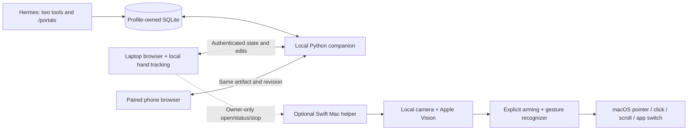

# Architecture

The Python adapter registers two tools and one command. It resolves
`plugins.plugin_storage.plugin_data_dir("hermes-portals")` on each invocation
so profiles keep separate databases. The companion is a separate Python process
started only by an explicit command, with a minimal environment that excludes
provider credentials and approval flags. No daemon or launch-at-login service
is installed.

Hermes and the companion share a profile-owned SQLite workspace and tool library. Web clients
send schema-validated REST mutations with an expected revision. Read-only
WebSockets push changes and periodic heartbeats; the service notices native
Hermes edits through a short database poll. Reconnecting clients receive a full
snapshot. The browser keeps no independent authoritative saved copy. Numeric
previews are committed before changing tools or handing off. Version 0.1
diagrams migrate without changing their identity or interaction state.

The laptop tracks 21 hand landmarks locally using pinned MediaPipe assets. Its
gesture recognizer uses palm-normalized pinch distance, hysteresis, a hold time,
minimum movement, a target region and a cooldown. Missing hands cancel grabs.
Gestures use exactly the same validated handoff endpoint as the transfer button.

The optional Swift/AppKit helper uses AVFoundation and Vision on a separate
camera queue. Its pure recognizer emits bounded actions only after explicit
native control activation and a palm hold; Accessibility permission gates event
delivery. The helper accepts no remote input. A private heartbeat file and
stop-request file connect it to the companion. Native open/status/stop routes
require both the authenticated owner and a loopback connection/origin.

## Access boundaries

See the [README disclosures](../README.md#before-you-install) and
[security policy](../SECURITY.md) for permissions, storage, network traffic and
process lifecycles. The browser practice area uses the same hand recognizer but
keeps its sample state inside the page; it cannot call the real handoff path.
